# Matriz de Pruebas y Evidencias — Control de Equipos de Laboratorio

**Asignatura:** Programación de Aplicaciones de Escritorio  
**Estudiante:** Moisés Abraham Valle Alonso  
**Base de Datos:** PostgreSQL (`bd_laboratorio_orm` / esquema `laboratorio`)  
**Tecnologías:** Java 21, JavaFX 21, Hibernate ORM 7.0.4 (Jakarta Persistence), PostgreSQL JDBC 42.7.13  

---

## 0. Estado Inicial de la Aplicación

Carga inicial de los tipos de equipo y del catálogo de 10 equipos persistidos en PostgreSQL al iniciar `Launcher`:

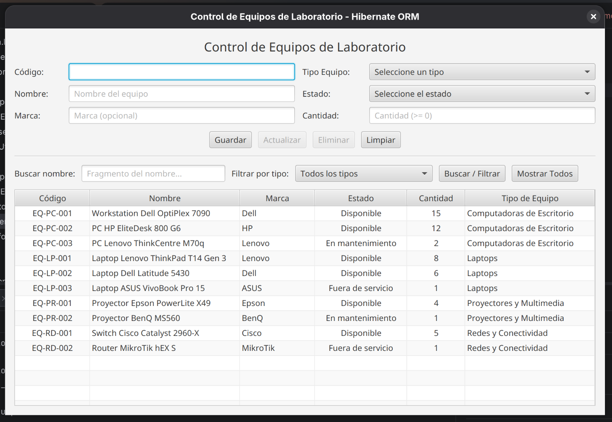

---

## 1. Matriz de Pruebas Obligatorias (P1 – P8)

| ID | Caso de Prueba | Datos de Entrada | Resultado Esperado | Resultado Obtenido | Estado | Evidencia(s) |
| :--- | :--- | :--- | :--- | :--- | :---: | :--- |
| **P1** | Registrar un equipo válido | Código: `EQ-PC-004` Nombre: `Monitor Dell UltraSharp 24` Marca: `Dell` Cantidad: `6` Tipo: `Computadoras de Escritorio` Estado: `Disponible` | Registro guardado en PostgreSQL mediante `persist()` y `commit()`, visible en el `TableView`. | Se ingresaron los datos en el formulario, se mostró la alerta de confirmación y el registro apareció en la tabla y en PostgreSQL. | ✅ Aprobado | 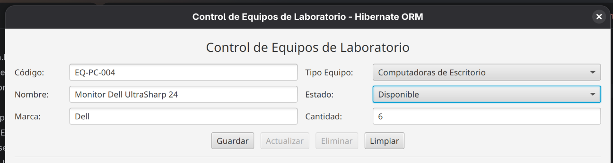 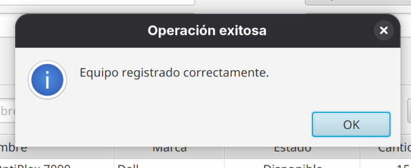 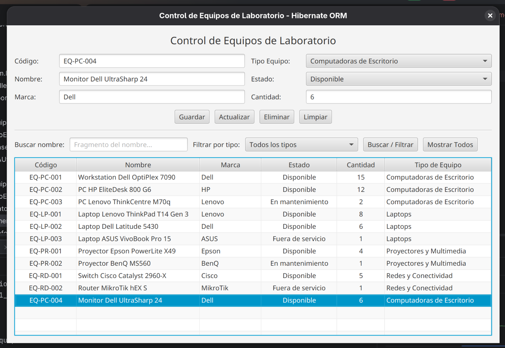 |
| **P2** | Intentar código duplicado | Código: `EQ-PC-001` (ya existente) Nombre: `PC Prueba Duplicado` Marca: `HP` Cantidad: `2` Tipo: `Computadoras de Escritorio` Estado: `Disponible` | Operación rechazada con alerta comprensible; sin registros duplicados en la BD. | El sistema bloqueó el registro mostrando la alerta de validación de código duplicado y mantuvo intacta la tabla. | ✅ Aprobado | 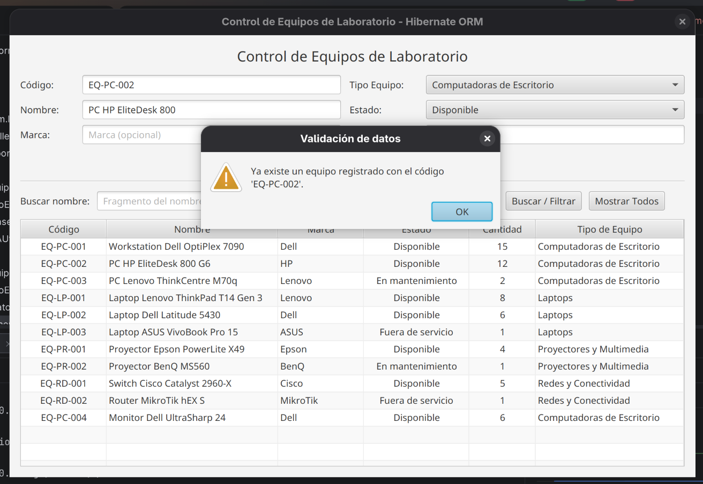 |
| **P3** | Editar nombre, estado o tipo | Selección: `EQ-PC-004` Modificación de atributos/estado/tipo y clic en **Actualizar**. | Cambios actualizados mediante `merge()` y `commit()`, persistidos en PostgreSQL. | Se seleccionó el equipo, se modificaron sus datos, se confirmó la actualización y el `TableView` reflejó los cambios. | ✅ Aprobado | 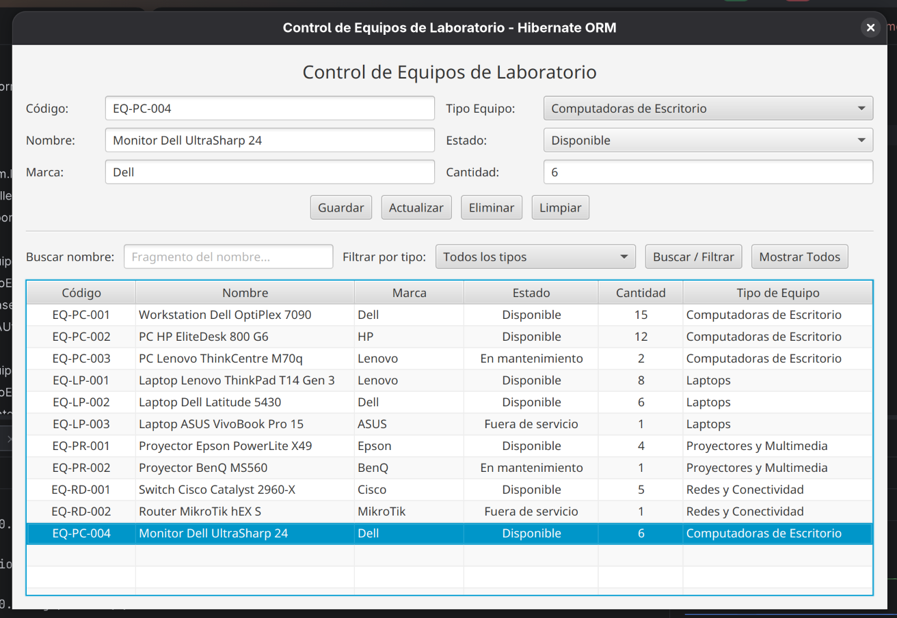 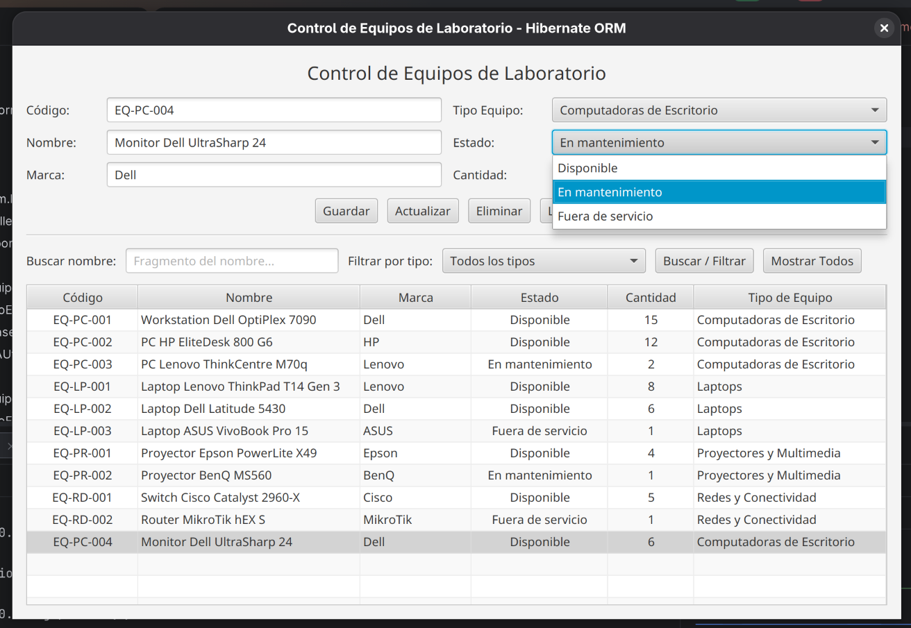 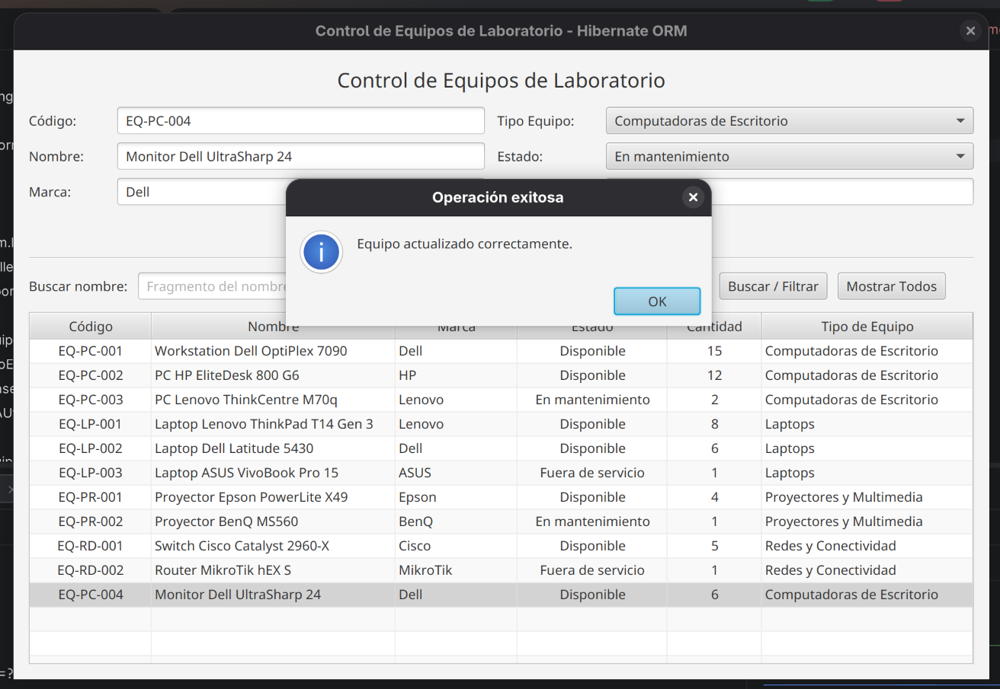 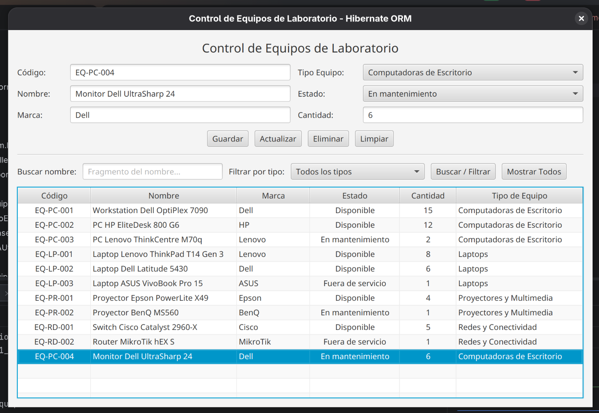 |
| **P4** | Eliminar un equipo con confirmación | Selección: `EQ-PC-004` Acción: Clic en **Eliminar** y confirmar en `Alert.CONFIRMATION`. | El registro se elimina mediante `remove()` dentro de transacción y desaparece del listado y de PostgreSQL. | Tras confirmar el diálogo de seguridad, el equipo fue eliminado de la interfaz y confirmado ausente en PostgreSQL. | ✅ Aprobado | 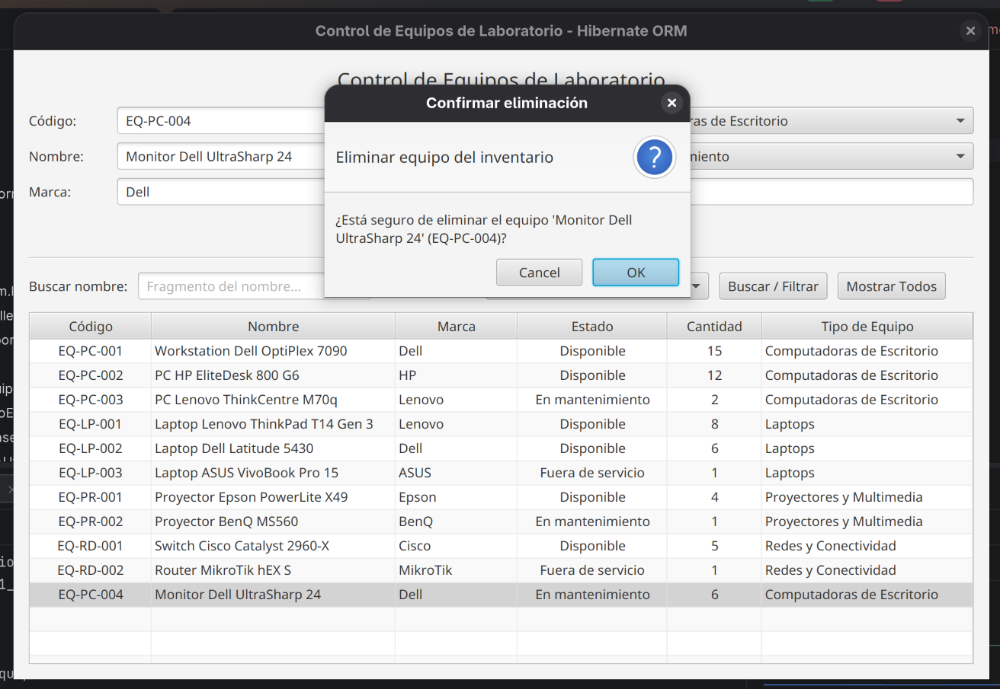 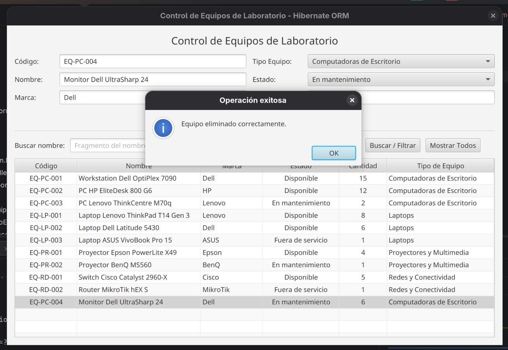 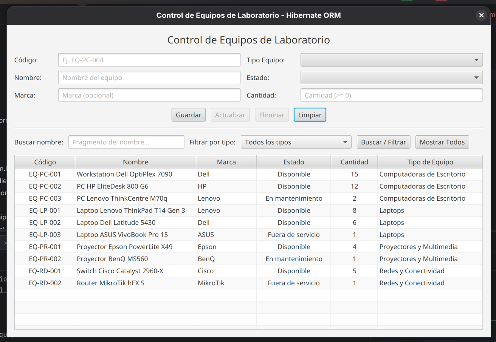 |
| **P5** | Buscar por nombre parcial | Buscar nombre: `Think` Filtrar por tipo: `Todos los tipos` | Solo se muestran los equipos cuyo nombre contiene `"Think"` (insensible a mayúsculas). | El `TableView` filtró únicamente los registros coincidentes con el fragmento ingresado. | ✅ Aprobado | 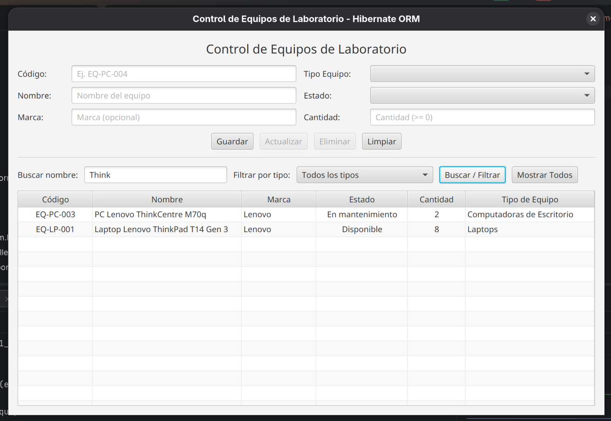 |
| **P6** | Filtrar por tipo y combinar con búsqueda | Buscar nombre: `Think` Filtrar por tipo: `Laptops` | Solo se muestran los registros que cumplen ambas condiciones simultáneamente (`AND`). | Se mostró únicamente el equipo que cumple tanto el filtro de texto como el tipo de equipo seleccionado. | ✅ Aprobado | 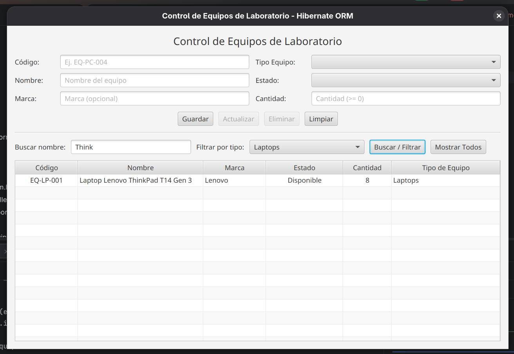 |
| **P7** | Ingresar cantidad negativa | Código: `EQ-TEST-01` Nombre: `Equipo Negativo` Cantidad: `-3` Tipo: `Laptops` Estado: `Disponible` | Validación rechaza el dato antes de persistir y muestra alerta sin registrar en BD. | Se desplegó alerta de validación indicando que la cantidad debe ser un entero `>= 0`. | ✅ Aprobado | 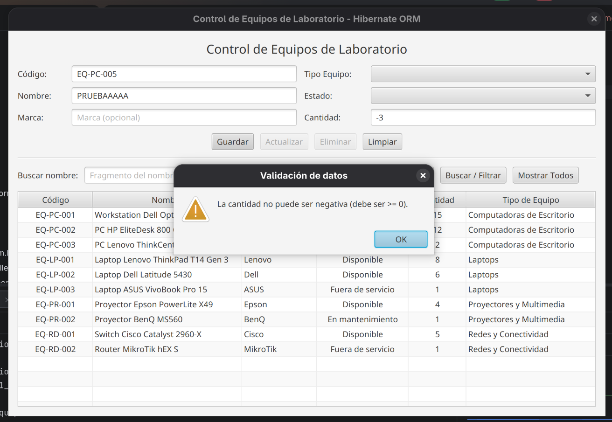 |
| **P8** | Reiniciar aplicación | Cerrar completamente la ventana JavaFX y volver a ejecutar `Launcher`. | Todos los datos previamente confirmados persisten al recargar desde PostgreSQL. | Al reiniciar la aplicación, todos los cambios confirmados se cargaron intactos desde PostgreSQL. | ✅ Aprobado | 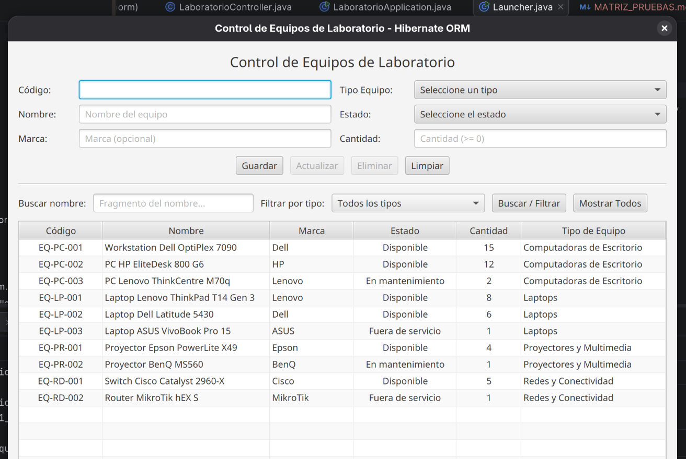 |

---

## 2. Demostración de Fallo de Integridad y Uso de `rollback()`

* **Escenario probado:** Intento de inserción directa de un equipo con código duplicado (`EQ-PC-001`) omitiendo temporalmente la validación preventiva en el controlador para forzar la violación de la restricción `UNIQUE` (`uq_equipo_codigo`) en PostgreSQL durante `tx.commit()`[cite: 4].
* **Comportamiento de la transacción en `EquipoDAO.guardar()`:**
  1. Se inicia la unidad de trabajo con `EntityManager em = JPAUtil.getEntityManager()` y se abre la transacción con `tx.begin()`[cite: 3].
  2. Se asocia la entidad administrada `TipoEquipo` y se invoca `em.persist(equipo)`[cite: 3].
  3. Al ejecutar `tx.commit()`, PostgreSQL rechaza la inserción por violación de clave única (`ConstraintViolationException` / `RollbackException`).
  4. El bloque `catch (RuntimeException ex)` verifica `if (tx.isActive()) { tx.rollback(); }`, revirtiendo la transacción por completo y asegurando que no queden registros parciales o inconsistentes en la base de datos[cite: 3, 4].
  5. El bloque `finally` cierra el `EntityManager` (`em.close()`) y la interfaz muestra una alerta descriptiva del error sin cerrarse[cite: 2, 4].

* **Evidencia:**

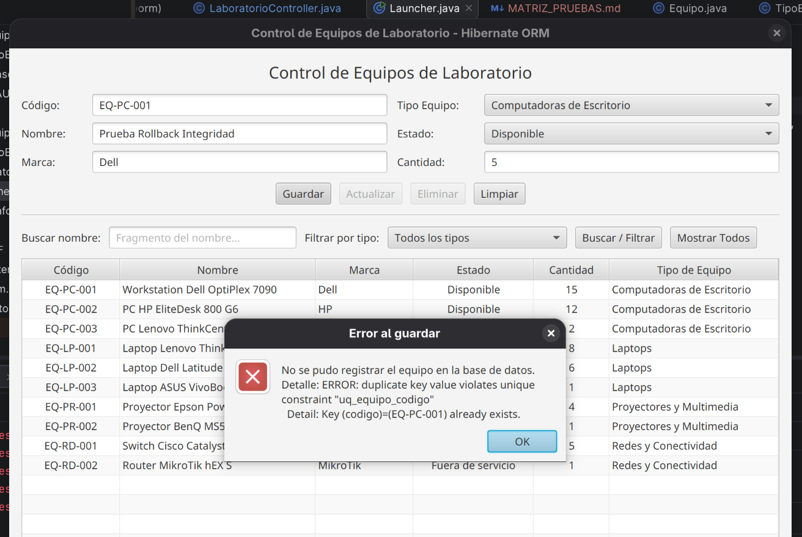